# Flowchart logic nghiệp vụ

Sơ đồ luồng xử lý của các đối tượng chính trong CSDL `QL_CAFE_NHAHANG`, vẽ từ mã trong
[`sql/05_ThuTuc_Ham.sql`](../sql/05_ThuTuc_Ham.sql) và [`sql/06_Trigger_GiaoTac.sql`](../sql/06_Trigger_GiaoTac.sql).
Các sơ đồ dùng Mermaid, hiển thị trực tiếp trên GitHub.

Quy ước: hình thoi là điều kiện kiểm tra; ô đỏ nhạt là lỗi (`THROW`, kèm mã lỗi); ô xanh nhạt là kết thúc thành công.

## Mục lục

1. [Vòng đời hóa đơn và trạng thái bàn](#1-vòng-đời-hóa-đơn-và-trạng-thái-bàn)
2. [`sp_MoHoaDon`](#2-sp_mohoadon)
3. [`sp_GoiMon`](#3-sp_goimon)
4. [`sp_ThanhToan`](#4-sp_thanhtoan)
5. [`sp_HuyHoaDon`](#5-sp_huyhoadon)
6. [`sp_ThongKeDoanhThu`](#6-sp_thongkedoanhthu)
7. [`fn_DanhSachMonTheoLoai`](#7-fn_danhsachmontheoloai)
8. [Trigger `trg_ChiTietHoaDon_KiemTraNguyenLieu` (TR01)](#8-trigger-trg_chitiethoadon_kiemtranguyenlieu-tr01)
9. [Trigger `trg_HoaDon_CapNhatBan` (TR02)](#9-trigger-trg_hoadon_capnhatban-tr02)
10. [Trigger `trg_Mon_KiemTraXoa` (TR03)](#10-trigger-trg_mon_kiemtraxoa-tr03)
11. [Giao tác GT01: gọi nhiều món (all-or-nothing)](#11-giao-tác-gt01-gọi-nhiều-món-all-or-nothing)
12. [Giao tác GT02: thanh toán có SAVEPOINT](#12-giao-tác-gt02-thanh-toán-có-savepoint)

---

## 1. Vòng đời hóa đơn và trạng thái bàn

Tổng quan cách các thủ tục và trigger phối hợp. Trạng thái bàn do `sp_*` và trigger `trg_HoaDon_CapNhatBan` cùng giữ đồng bộ.

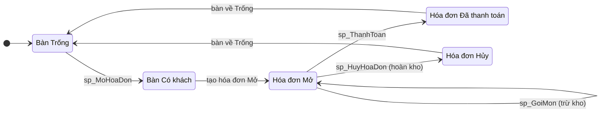

---

## 2. `sp_MoHoaDon`

Mở hóa đơn mới cho một bàn. Tham số: `@MaBan`, `@MaNV`, `@MaHD OUTPUT`.

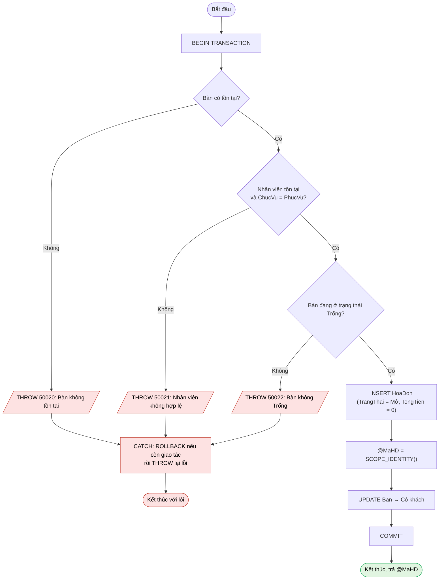

---

## 3. `sp_GoiMon`

Gọi một món vào hóa đơn đang mở. Tham số: `@MaHD`, `@MaMon`, `@SoLuong`.
Hai nhánh cuối khác nhau cách trừ kho: nếu **dòng chi tiết mới**, trigger TR01 tự trừ kho khi `INSERT`;
nếu **món đã có** trong hóa đơn thì thủ tục tự cộng số lượng và trừ kho.

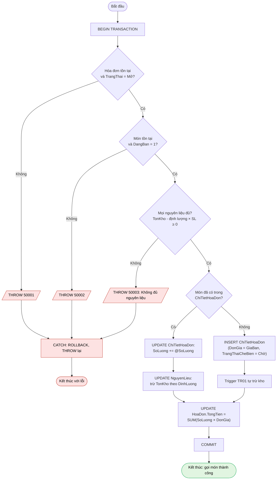

---

## 4. `sp_ThanhToan`

Tham số: `@MaHD`, `@TongTienThucThu OUTPUT`.

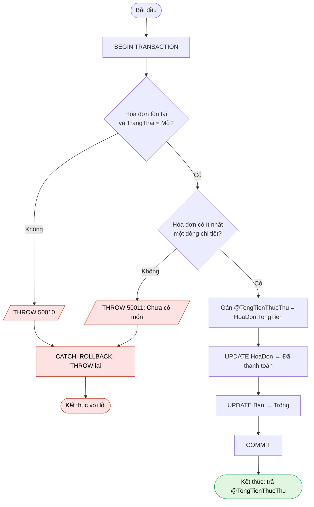

---

## 5. `sp_HuyHoaDon`

Hủy hóa đơn đang mở và hoàn trả nguyên liệu bằng con trỏ.

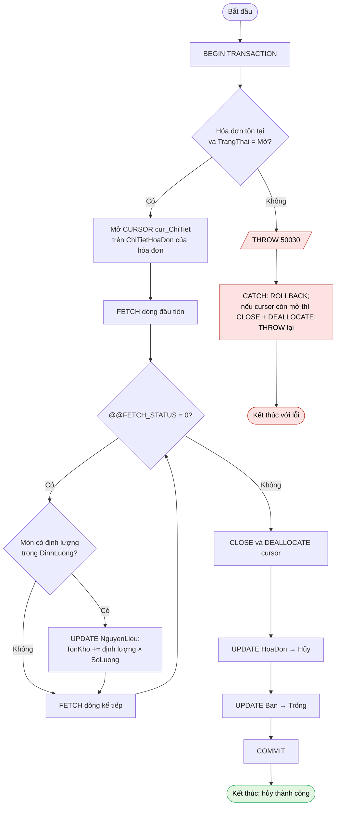

---

## 6. `sp_ThongKeDoanhThu`

Tham số: `@Nam`, `@ThangBatDau = 1`, `@ThangKetThuc = 12`. Chỉ đọc dữ liệu, không dùng giao tác.

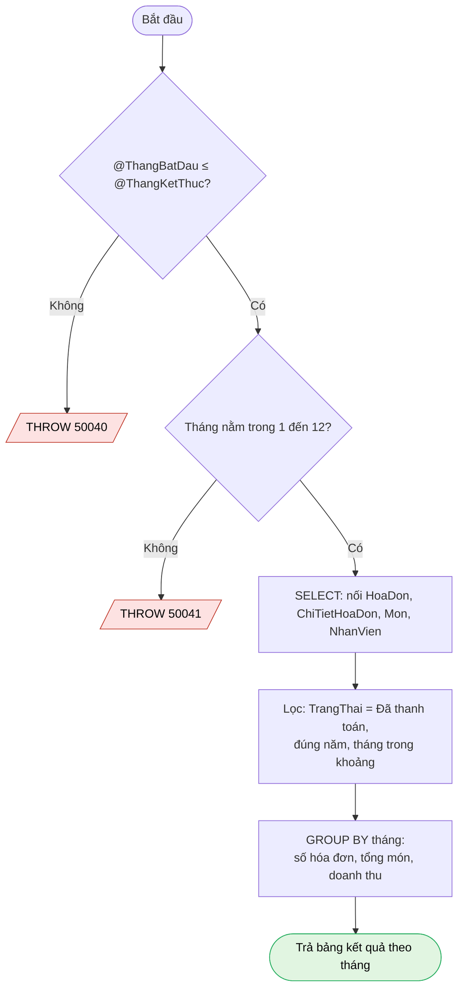

---

## 7. `fn_DanhSachMonTheoLoai`

Hàm bảng nhiều câu lệnh. Tham số: `@MaLoai`, `@BaoGomConChau = 0`.

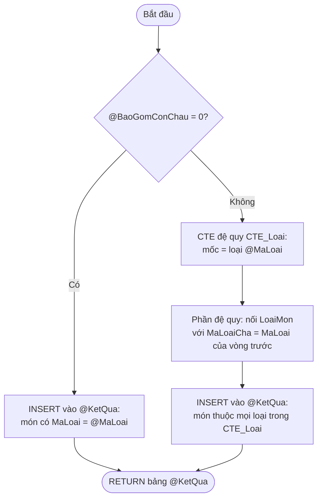

---

## 8. Trigger `trg_ChiTietHoaDon_KiemTraNguyenLieu` (TR01)

`AFTER INSERT` trên `ChiTietHoaDon`, xử lý nhiều dòng một lần. Gom nhu cầu theo nguyên liệu trước khi so với tồn kho,
để tránh sót trường hợp nhiều món cùng dùng một nguyên liệu trong một lệnh `INSERT`.

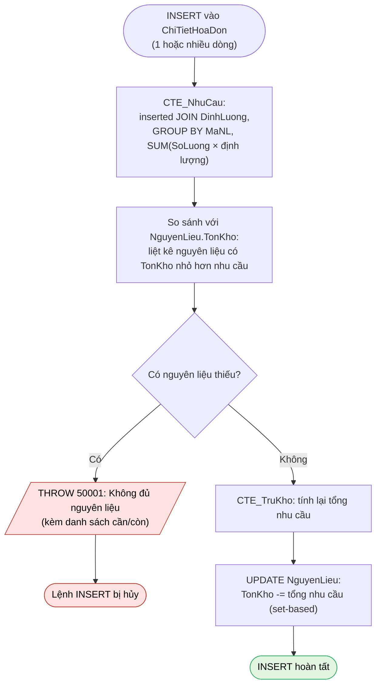

---

## 9. Trigger `trg_HoaDon_CapNhatBan` (TR02)

`AFTER UPDATE` trên `HoaDon`. Đồng bộ trạng thái bàn khi trạng thái hóa đơn đổi.

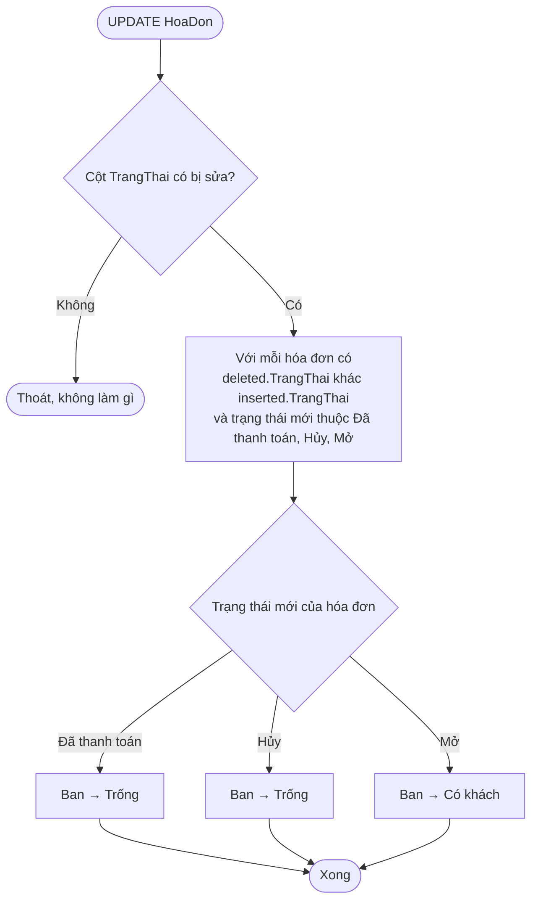

---

## 10. Trigger `trg_Mon_KiemTraXoa` (TR03)

`INSTEAD OF DELETE` trên `Mon`: không xóa thật, chỉ ẩn món (xóa mềm).

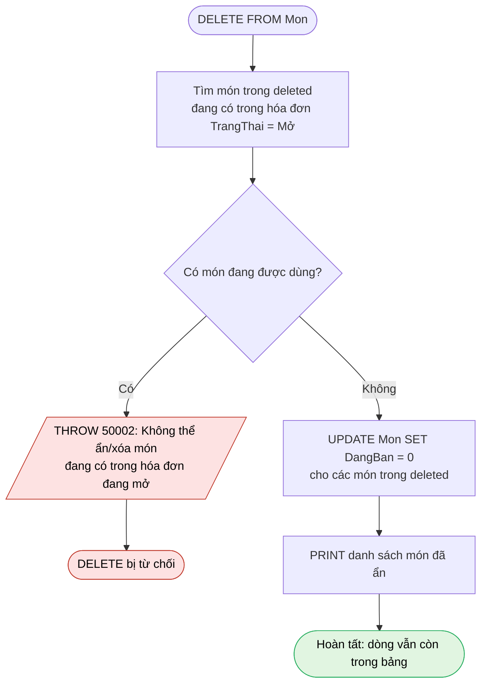

---

## 11. Giao tác GT01: gọi nhiều món (all-or-nothing)

Kịch bản minh họa tính nguyên tử: gọi món 1 và món 2 trong cùng một giao tác.
Ở GT01-A đủ nguyên liệu nên `COMMIT`. Ở GT01-B món 2 thiếu nguyên liệu nên trigger TR01 báo lỗi và `ROLLBACK` cả món 1.

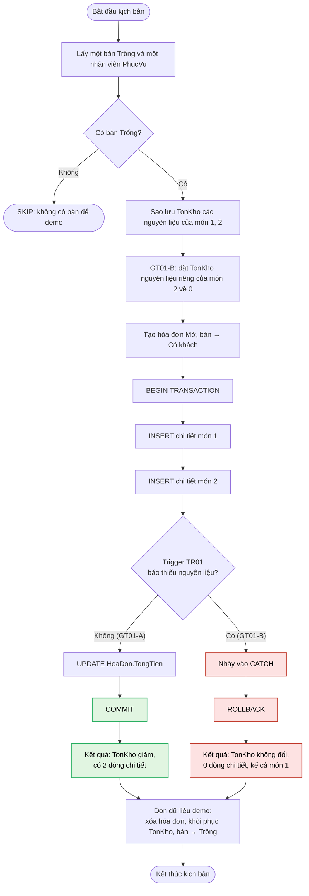

---

## 12. Giao tác GT02: thanh toán có SAVEPOINT

Minh họa phục hồi một phần với `SAVE TRANSACTION`.

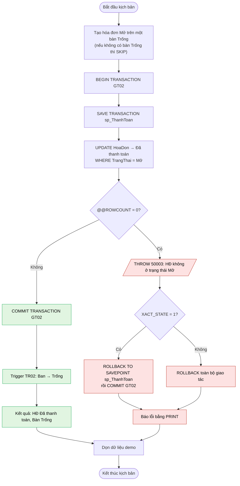
